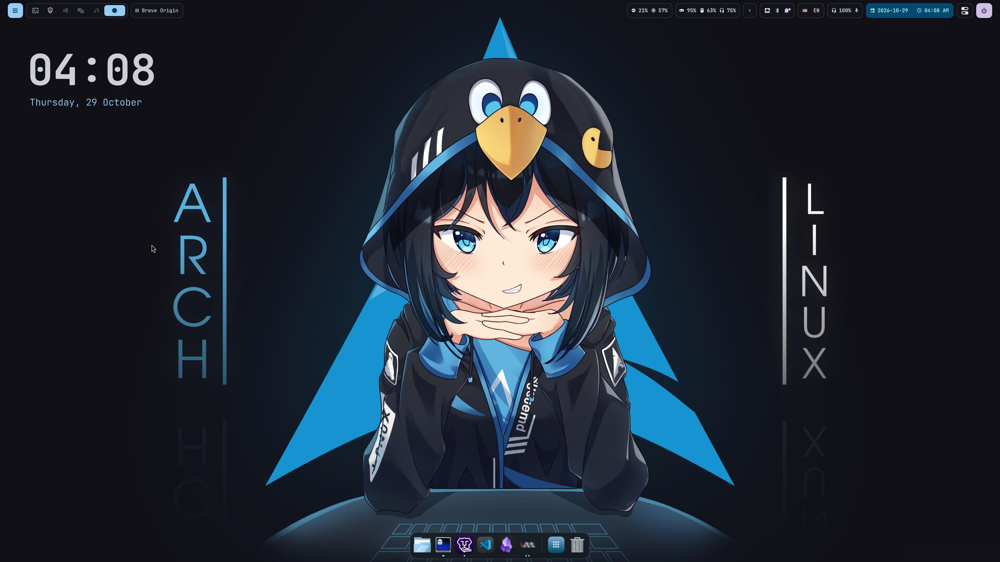
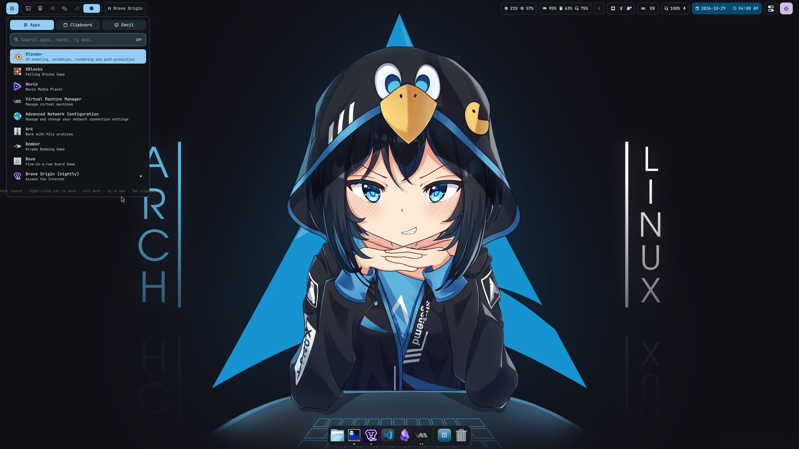
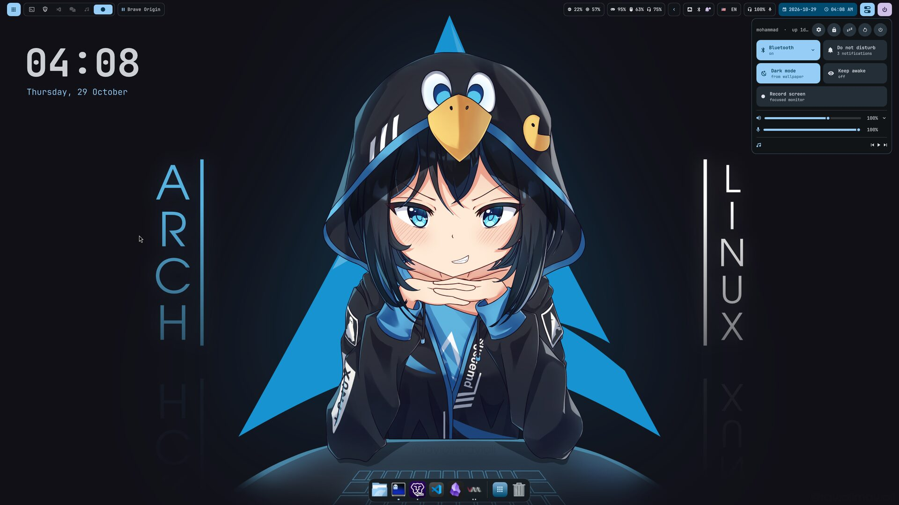
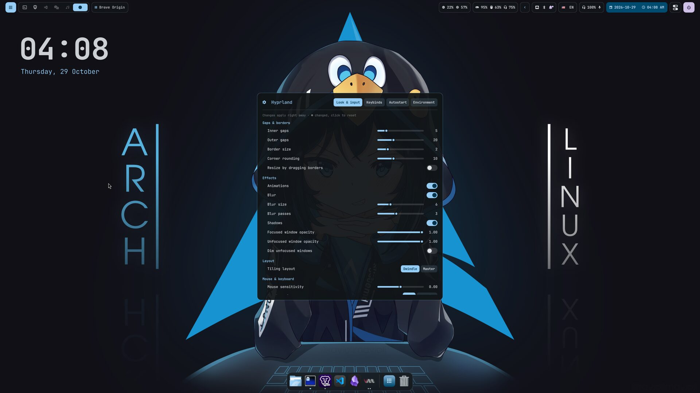
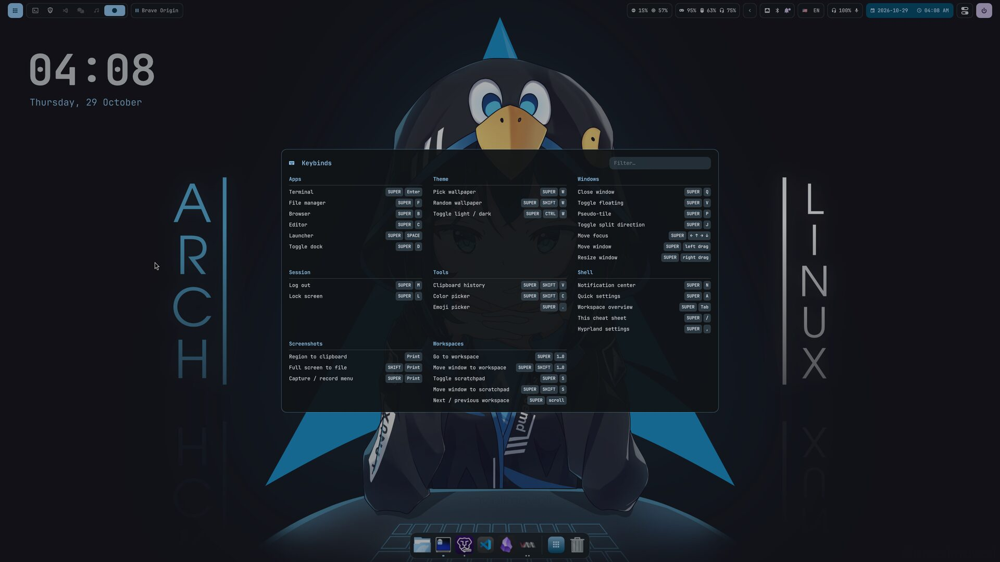
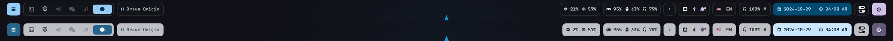

# Hyprland dotfiles

Hyprland (Lua config) · Quickshell bar/launcher/dock/notifications/OSD/lock · matugen colors from the wallpaper.

## Screenshots

| Launcher (`SUPER+SPACE`) | Quick settings (`SUPER+A`) |
|---|---|
|  |  |
| **Hyprland settings (`SUPER+,`)** | **Keybind cheat sheet (`SUPER+/`)** |
|  |  |

**Theme:** colors come from the wallpaper (matugen) and follow it into the bar, dock, terminals and KDE apps.
`SUPER+CTRL+W` switches dark / light:

## Install on a fresh Arch

Step-by-step from a clean `archinstall`: **[INSTALL.md](INSTALL.md)**.

Requirements: a fresh **Arch Linux** install, a normal user with **sudo**, and internet. Run it as that user, not root.

    bash <(curl -fsSL https://raw.githubusercontent.com/Haddadmj/dotfiles/main/setup.sh)

or `git clone https://github.com/Haddadmj/dotfiles ~/dotfiles && ~/dotfiles/install.sh`.

The installer asks for your password **once**, then what you want (package groups and the apps inside each, terminal, browser, file manager, editor, keyboard
layouts, gaps/borders/rounding, dark/light, NVIDIA hybrid GPU, login screen, Qt theming, zsh), shows the exact
package list for confirmation, backs up existing files to `~/.dotfiles-backup/`, then copies the config.

- Menus: arrow keys move, **x** ticks/unticks, **ctrl+a** ticks all, **enter** confirms
- Unattended: `cp setup.conf.example my.conf`, edit, `./install.sh -c my.conf -y`
- Change choices later without touching packages: `./install.sh -d`

## Dependencies

Everything below is installed by `install.sh` — this list is so you know what you're getting
(or can install it by hand). **(AUR)** = installed with paru, everything else is in the official repos.

### Installed first (bootstrap)

| Package | Why |
|---|---|
| `git`, `base-devel` | clone this repo, build AUR packages |
| `gum` | the installer's menus |
| `pciutils` | `lspci`, to detect NVIDIA / integrated GPUs |
| `paru-bin` **(AUR)** | AUR helper; built from the AUR if missing |
| `[multilib]` repo | enabled if you say yes — needed for `lib32-*` (NVIDIA, gaming) |

### core — always installed, the desktop won't work without these

| Package | Why |
|---|---|
| `hyprland` | the compositor (0.56+, Lua config) |
| `quickshell` | bar, launcher, dock, notifications, OSD, lock screen, settings panel |
| `matugen` | generates colors from the wallpaper (`scripts/theme.sh`) |
| `hyprpaper` | wallpaper |
| `python` | theme browser backend (`scripts/theme-store.py`) |
| `hypridle`, `hyprlock` | idle timeout, screen lock |
| `hyprlauncher`, `hyprpicker`, `hyprshot`, `hyprshutdown` | app menu, color picker, screenshots, shutdown dialog |
| `xdg-desktop-portal-hyprland`, `xdg-desktop-portal-gtk` | screen sharing, file pickers (no Plasma needed) |
| `qt5-wayland`, `qt6-wayland` | Qt apps on Wayland |
| `breeze`, `breeze-gtk` | Qt/GTK theme, Breeze icons and cursor |
| `pipewire`, `pipewire-alsa`, `pipewire-pulse`, `pipewire-jack`, `wireplumber`, `pavucontrol` | audio |
| `networkmanager`, `network-manager-applet` | network + tray icon |
| `bluez`, `bluez-utils` | Bluetooth |
| `polkit-kde-agent`, `kwallet-pam` | admin password prompts; KWallet unlock at login (with sddm / plasma-login-manager) |
| `cliphist`, `wl-clipboard` | clipboard history |
| `wofi` | fallback wallpaper picker |
| `wf-recorder`, `satty` | screen recording, screenshot editing |
| `libvips`, `libnotify`, `jq`, `rsync` | wallpaper thumbnails, notifications, scripts |
| `headsetcontrol`, `btop` | headset battery and system monitor in the bar |
| `xdg-user-dirs` | Pictures/Videos/… folders |
| `ttf-jetbrains-mono-nerd`, `ttf-nerd-fonts-symbols`, `otf-font-awesome`, `noto-fonts`, `noto-fonts-emoji` | UI font and the bar's icons, text, emoji picker |

### Optional groups (none are pre-ticked — pick them in the installer, then untick single apps inside each)

| Group | Packages |
|---|---|
| **fonts** | `ttf-meslo-nerd` (powerlevel10k prompt) `noto-fonts-cjk` `ttf-dejavu` `ttf-liberation` — extras; the essential fonts are in core |
| **nvidia** | `nvidia-open` `nvidia-utils` `lib32-nvidia-utils` `nvidia-settings` `nvidia-prime` `libva-nvidia-driver` `linux-headers` — *tick it on NVIDIA machines; the installer tells you when it finds one* |
| **kde-apps** | `dolphin` `dolphin-plugins` `ark` `kate` `okular` `gwenview` `spectacle` `kcalc` `kfind` `ffmpegthumbs` `kdegraphics-thumbnailers` `kio-admin` `partitionmanager` `kwalletmanager` |
| **shell** | `zsh` `fzf` `zoxide` `eza` `bat` `fd` `dust` `duf` `fastfetch` `git-delta` `tldr` `micro` `pkgfile` + oh-my-zsh, powerlevel10k, fzf-tab, zsh-autosuggestions, zsh-syntax-highlighting, zsh-completions, you-should-use (git clones) |
| **apps** | `obsidian` `mpv` `solaar` `piper`, **(AUR)** `vesktop-bin` `code-features` `code-marketplace` `input-remapper-git` `t3code-nightly-bin` `nuviodesktop-bin` `pear-desktop-bin` `vicinae-bin` `obs-studio-tytan652` `obs-pipewire-audio-capture` |
| **gaming** | `gamemode` `lib32-gamemode` `lib32-pipewire` `lib32-vulkan-icd-loader` `retroarch` + assets/cores `dolphin-emu` `prismlauncher` `kde-games-meta`, **(AUR)** `pcsx2-latest-bin` `rpcs3-bin` |
| **dev** | `cmake` `ninja` `extra-cmake-modules` `jdk17-openjdk` `uv` `scdoc` `blender` `kdenlive` `kdevelop` |
| **virt** | `qemu-desktop` `libvirt` `virt-manager` `edk2-ovmf` `swtpm` `dnsmasq` |

### From your choices

| Choice | Options → package |
|---|---|
| Terminal | `ghostty` · `kitty` · `alacritty` · `foot` — only `ghostty` gets the wallpaper colours |
| Browser | `brave-origin-nightly-bin` (AUR) · `brave-bin` (AUR) · `firefox` · `chromium` · `zen-browser-bin` (AUR) |
| File manager | `dolphin` · `nautilus` · `thunar` · `nemo` |
| Editor | `code` · `kate` · `zed` · `gnome-text-editor` |
| Login screen | `sddm` (graphical, adds Xorg) · `ly` (lightweight terminal UI) · `plasma-login-manager` (pulls in Plasma) · none (Hyprland starts on TTY1 login) |
| Qt/KDE app theming | `qt6ct-kde` (AUR) + `archlinux-xdg-menu` — no Plasma · `plasma-integration` — KDE's own, pulls in Plasma |

Package lists live in `packages/*.txt` — edit them to add or remove things.

## NVIDIA hybrid graphics

If the machine has an NVIDIA card **and** an integrated GPU, the installer can write
`/etc/udev/rules.d/99-gpu-names.rules` (detected from `lspci`) so Hyprland renders on the NVIDIA card.
If you don't pick the **nvidia** group, the NVIDIA-only env vars in `modules/env.lua` are commented out.

## Keybinds to know

`SUPER+,` settings panel · `SUPER+W` pick wallpaper · `SUPER+SHIFT+W` random wallpaper · `SUPER+CTRL+W` light/dark · `SUPER+I` / `SUPER+SHIFT+I` pick / next icon theme · `SUPER+U` / `SUPER+SHIFT+U` pick / next cursor theme · `SUPER+CTRL+U` / `SUPER+ALT+U` bigger / smaller cursor · `SUPER+CTRL+I` browse and download themes (Pling)

## Keep it up to date

    ./snapshot.sh && git add -A && git commit -m snapshot && git push

What gets saved is listed in `files.txt`. The wallhaven API key is never committed —
copy `~/.config/wallhaven/apikey` by hand.
